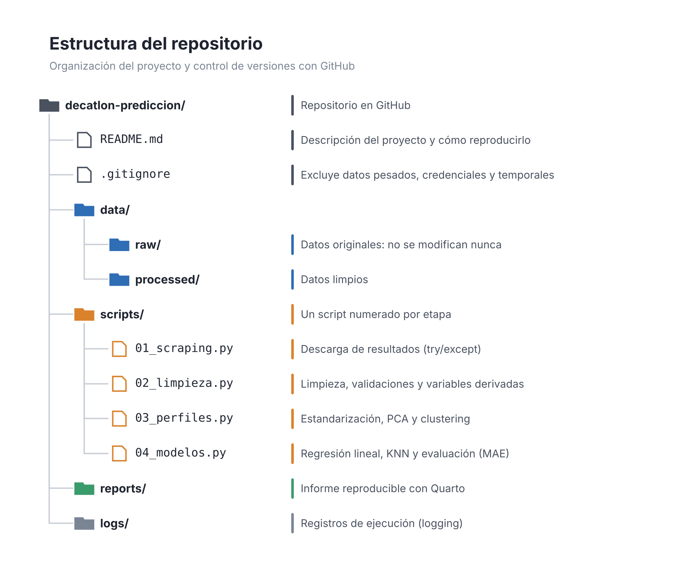

### 1. **Título del caso práctico**
¿Cuándo se decide un decatlón? Predicción en directo de la puntuación final según el perfil del atleta.

---

### 2. **Objetivo del análisis**
Determinar si es posible predecir los puntos totales con los que acabará cada decatleta a partir de los resultados acumulados tras cada prueba, y a partir de qué prueba esa predicción es fiable. Se analizará si incorporar el perfil del atleta (velocidad, fuerza, resistencia), obtenido mediante clustering, mejora la predicción, ya que dos atletas con los mismos puntos tras el primer día no tienen por qué acabar con el mismo total. El objetivo es ofrecer una clasificación prevista en directo útil para espectadores y medios, para entrenadores que quieren saber si su atleta va camino de su objetivo y para entrenadores rivales que deben tomar decisiones tácticas en las últimas pruebas.

---

### 3. **Datos necesarios**
- Variables:
  - Del atleta: identificador, nombre, sexo, fecha de nacimiento y país.
  - De la competición: nombre, fecha, lugar, tipo (aire libre o pista cubierta) y nivel.
  - De cada una de las 10 pruebas: marca, puntos obtenidos, estado (válida, nulo, no terminada, no presentado) y viento (100 m, longitud y 110 m vallas).
  - Resultado final: puntos totales y posición final.
  - Coeficientes de la tabla oficial de puntuación de cada prueba.
- Fuentes:
  - Resultados oficiales de World Athletics (webscraping).
  - Histórico de competiciones de Decathlon2000.com (CSV o webscraping).
  - Dataset `decathlon` del paquete FactoMineR para construir y probar el proceso.
  - Tablas de puntuación de World Athletics (PDF) para los coeficientes.
- Alcance: decatlones masculinos de 2014 a 2025 (estimación: unas 3.000 filas, una por atleta y competición).
- Formato: CSV.

---

### 4. **Transformaciones y limpieza**
- Gestionar marcas no numéricas ("DNF", "DNS") con una columna de estado; un nulo en un concurso equivale a 0 puntos.
- Excluir los decatlones incompletos, registrando cuántos se eliminan.
- Normalizar unidades (saltos en m, lanzamientos en m, carreras en s) y separador decimal.
- Unificar nombres de atletas (tildes, mayúsculas).
- Crear variables derivadas:
  - Puntos recalculados con la fórmula oficial, como control de calidad.
  - Puntos acumulados y posición tras cada prueba.
  - Mejor total previo del atleta.
  - Referencia de potencial = suma de puntos de sus mejores marcas de la temporada.
  - Variables estandarizadas (media 0, desviación 1).
- Herramientas: "pandas" y "numpy" (Python).

---

### 5. **Análisis y herramientas**
- Métodos:
  - Estadística descriptiva (media, desviación estándar) y matriz de correlación entre pruebas.
  - Estandarización de variables y PCA para resumir las 10 pruebas en 2-3 ejes.
  - Clustering para obtener perfiles de atleta.
  - Modelos predictivos tras cada prueba (de la 1 a la 9): regresión lineal y vecinos cercanos (KNN).
  - Evaluación con división temporal (entrenamiento 2014-2022, evaluación 2023-2025) mediante el error absoluto medio (MAE).
  - Comparación con dos referencias: ingenua (extrapolar los puntos acumulados) y de potencial (suma de mejores marcas de la temporada).
  - La predicción se considera fiable a partir de la prueba en la que el MAE baja de 100 puntos.
- Librerías:
  - Python: "pandas", "numpy", "requests", "BeautifulSoup", "scikit-learn", "matplotlib", "seaborn".

- Uso de LLM:
  - Prompt:
    ```
    Eres un analista de rendimiento en atletismo que explica resultados a entrenadores sin formación estadística. A continuación tienes los perfiles de decatletas obtenidos mediante clustering (puntos medios por prueba de cada grupo) y el error medio de predicción tras cada prueba para cada perfil.
    [tabla de datos]
    Tareas:
    1. Pon un nombre descriptivo a cada perfil y explica en dos frases qué lo caracteriza.
    2. Explica en lenguaje sencillo en qué momento de la competición se vuelve fiable la predicción para cada perfil.
    3. Propón dos recomendaciones prácticas para un entrenador.
    Usa solo los datos proporcionados. No calcules ni inventes cifras nuevas. Responde en un máximo de 250 palabras.
    ```
  - Función: traducir los resultados técnicos a un lenguaje comprensible para el cuerpo técnico. Todos los cálculos se hacen en Python; el LLM solo interpreta, para evitar que invente cifras.

---

### 6. **Visualización y comunicación**
- Gráficos:
  - Línea: error medio (MAE) tras cada prueba, con modelos, referencias y umbral de fiabilidad.
  - Radar: perfil medio de cada grupo de atletas.
  - Dispersión del PCA coloreada por perfil.
  - Mapa de calor: correlaciones entre pruebas.
  - Bump chart: evolución de la posición prueba a prueba (prevista frente a real).
  - Dispersión: total previsto frente a total real.
- Informe reproducible con **Quarto**:
  - Introducción, datos, metodología, resultados, conclusiones.
  - Código y gráficos integrados.

---

### 7. **Gestión del proyecto**
- Organización: carpetas separadas para datos, scripts, informe y logs (ver esquema).
- Control de versiones: repositorio en GitHub con `README.md`, un commit por etapa y `.gitignore` para no subir datos ni credenciales.
- Tratamiento de errores: `try/except` en el scraping, validación de los puntos en la limpieza y `logging` para registrar fallos y filas eliminadas.

{width=100%}
